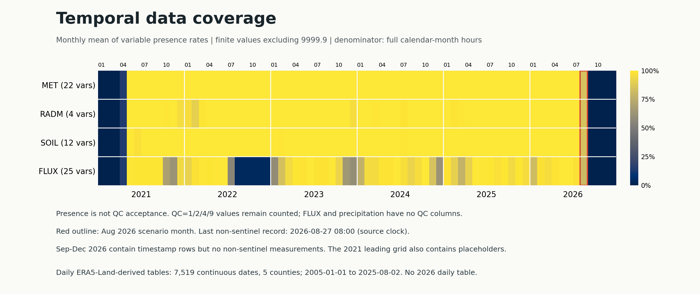

# B 赛道时序资料审计

审计日期：2026-10-23（用户本地日期）。范围仅为原始附件 01、02。原始文件只读，未补值、未重采样、未按物理阈值或 QC 删值，未进行相关性、阈值、预测或灾害机制建模。

## 1. 可直接采用的审计结论

1. **小时数据的时间网格完整，但测量值不覆盖整个 2021—2026 年。** 24 份 CSV 分为 MET、RADM、SOIL、FLUX 四类，每类均有 52,584 个小时，时间戳从 2021-01-01 00:00 至 2026-12-31 23:00 连续。所有文件均无时间解析失败、重复时间戳、非 1 小时相邻步长或文件年份外记录。
2. **四类资料首个有数值的时刻均为 2021-04-23 11:00，最后均为 2026-08-27 08:00。** 这是“至少一个测量字段为有限且非 9999.9 数值”的边界，不代表中间每个变量完整，也不代表 QC 通过。2026-08-27 09:00 以后仍有时间戳，但所有测量字段均为缺失标记。
3. **2026-08-26 当日的 63 个测量字段均有 24/24 个数值。** 其中带 QC 的 37 个字段当日全部为 QC=0。降水与 FLUX 的 25 个字段没有 QC 列，不能据此声明其通过质量控制。窗口采用该日期的日历日，并未认定真实灾害发生小时。
4. **前 30 个日历日中，MET、RADM、SOIL 的数值在场率均为 100%，但个别风速、风向、辐射有非零 QC。** FLUX 个别变量仅 677/720 小时在场。必须把缺失与质量标记分开处理。
5. **FLUX 的历史可用性与其他三类差异明显。** 2022 年多个字段自 07-17 21:00 至年底连续 4,011 小时缺失。不能因同一文件仍有气压、探头等字段就判断整套 FLUX 完整。
6. **每日温度实际范围为 2005-01-01 至 2025-08-02。** 21 份 XLSX、5 县，共 7,519 个连续日期，无重复日或期间缺日，37,595 个县日单元格均为有限数值。2005—2024 每年完整，2025 只有 214 天，全年后 151 天未提供。没有 2026 年逐日温度文件。

以上结论的机器证据见 [summary.json](../audit/temporal/summary.json)、[小时文件汇总](../audit/temporal/hourly_files.csv)、[每日工作簿汇总](../audit/temporal/daily_workbooks.csv)。

## 2. 口径、来源与版本边界

### 2.1 本次审计口径

| 术语 | 本次定义 | 不能据此推断的内容 |
|---|---|---|
| 时间戳在场 | 原始行有可解析时间戳 | 该行有真实测量值 |
| 数值在场 | 可转为有限数值，且不等于 9999.9 | 数值物理合理、QC 通过、满足建模条件 |
| 数值在场率 | 数值在场数量 / 对应完整日历窗口小时数 | 质量合格率 |
| QC 原值 | 原始表中的标记分布与数值状态交叉表 | 已完成统一清洗 |
| 记录边界 | 该类至少一个字段有数值的最早、最晚时刻 | 所有变量的共同有效区间 |
| 连续缺失段 | 原始文件顺序中的连续无数值记录 | 已确认仪器停机原因 |

小时的 9999.9 缺失定义来自同名资料的 [WaterNet 元数据镜像](https://gwfnet.net/Metadata/Index/T-2026-08-28-p1f3e5qIqTEyibfPAp3smBeA)（访问 2026-10-23）。该镜像声明北京时间 UTC+8，QC 0/1/2/4/8/9 分别表示正确、可疑、错误、插补、缺失、未质控。**本地文件未附时区后缀，且尚未与镜像下载文件逐份比对哈希，因此这些属于外部元数据声明，须保留版本核对事项。**

本地 MET/RADM/SOIL 按“测量字段之后紧邻的 QC_ 字段”配对，保留 `QC_Rsd`、`QC_rsu` 等实际大小写。`Precip(mm)` 与 FLUX 没有紧邻 QC 字段，不生成或推定它们的质量标记。每日资料未附 9999.9 定义；脚本仅盘点这个候选值，本次实际出现次数为 0。

### 2.2 两项重要的外部声明与本地观察差异

- 元数据宣称开始日为 **2021-04-26**，本地文件在 **2021-04-23 11:00** 已有非哨兵数值。差异不能在清洗时悄悄消除；应取得发布方说明或原下载说明后决定分析起点。
- 元数据给出的观测站为 **28.86°N、85.29°E、海拔 4,140 m**，距离受灾口岸约 **65 km**，并限制其作为灾区局地气象和直接触发机制证据的使用。后续资料字典应明确“区域背景站点”与“灾害沟谷局地”尺度，不能把表内降水列直接重命名为灾区局地降水。来源同上。

## 3. 小时文件与变量盘点

| 类别 | 文件数 | 每年测量字段数 | 每年 QC 字段数 | 主要内容 |
|---|---:|---:|---:|---|
| MET | 6 | 22 | 21 | 5 高度风速、风向、温度、湿度，以及气压、降水 |
| RADM | 6 | 4 | 4 | 短波、长波上下行四分量 |
| SOIL | 6 | 12 | 12 | 5 深度土温、含水率与 2 深度热通量 |
| FLUX | 6 | 25 | 0 | 风分量、声温、水汽及湍流/通量等 |

MET/RADM/SOIL 原始时间形式为 `Y-M-D H:mm`；FLUX 为 `Y/M/D H:mm`，部分 FLUX 文件含 UTF-8 BOM，读取时已支持。每年时间轴含全年小时，2024 年 8,784 行，其余各年 8,760 行。不得把全年行数当作全年有效样本数。

### 3.1 每年有数值的行数

下表为“至少一个测量字段在场 / 所有测量字段同时在场”。这两个指标可以快速发现 FLUX 的多变量可用性损失，详细单变量以 `hourly_variables.csv` 为准。

| 年份 | MET | RADM | SOIL | FLUX |
|---|---:|---:|---:|---:|
| 2021 | 5,986 / 5,951 | 5,955 / 5,944 | 5,986 / 5,760 | 5,788 / 4,890 |
| 2022 | 8,760 / 8,719 | 8,741 / 8,584 | 8,760 / 8,749 | 8,760 / 4,484 |
| 2023 | 8,760 / 8,758 | 8,759 / 8,703 | 8,760 / 8,680 | 8,760 / 6,501 |
| 2024 | 8,783 / 8,780 | 8,781 / 8,755 | 8,781 / 8,720 | 8,781 / 7,098 |
| 2025 | 8,760 / 8,759 | 8,760 / 8,732 | 8,760 / 8,747 | 8,760 / 7,739 |
| 2026 | 5,721 / 5,720 | 5,721 / 5,721 | 5,721 / 5,721 | 5,721 / 5,159 |

### 3.2 降水的特殊边界

`Precip(mm)` 各年首个数值比其他基本气象量有时晚一小时：2021 年为 04-23 12:00，2022—2026 年均为 01-01 01:00；年度起始 00:00 行为 9999.9。**这提示年度处理或小时累计边界值得核对，但本次未认定成因，也未用 0 填补。** 具体的小时累计区间（前一小时、后一小时或整点报告）尚无本地说明。

### 3.3 QC 原值概况

下表统计的是带 QC 字段的“字段 × 小时”单元格数，不能理解为独立事件样本数。

| 类别 | QC=0 | QC=1 | QC=2 | QC=4 | QC=8 | QC=9 |
|---|---:|---:|---:|---:|---:|---:|
| MET | 971,416 | 63 | 8,308 | 2,173 | 122,304 | 0 |
| RADM | 182,446 | 0 | 3,820 | 46 | 24,024 | 0 |
| SOIL | 558,250 | 0 | 2,565 | 1 | 70,191 | 1 |

本次数据中，所有 QC=8 的配对测量均不在场，所有其他已出现 QC 原值的配对测量均有数值。因而仅把 9999.9 转缺失仍会留下 **14,693 个 QC=2 数值**、**2,220 个 QC=4 数值**、63 个 QC=1 数值及 1 个 QC=9 数值。后续清洗策略需按用途规定，尤其要记录是否允许插补值进入验证集。

本次只记录极值，没有据极值删值。例如土壤 `VWC_0.8m(m3/m3)` 在 2022-08-24 18:00 的原始数值为 1.64，原始 QC=9，正是上表唯一一个 QC=9 单元格；辐射等也有需按质控和仪器定义复查的极值。其时间、原始 CSV 行号及配对 QC 见 [极值定位表](../audit/temporal/hourly_extrema.csv)。负数本身不构成统一删值理由，风分量、温度和部分通量允许有符号。

## 4. 2026-08-26 周边窗口

为了在不知道实际触发小时的情况下检查可用性，本次采用以下半开区间。若小时资料时区声明适用于本地文件，则按 UTC+8 日历理解；脚本未转换时区。

| 窗口 | 起点（含） | 终点（不含） | MET 每变量 | RADM 每变量 | SOIL 每变量 | FLUX 每变量 |
|---|---|---|---:|---:|---:|---:|
| 前 30 日 | 07-27 00:00 | 08-26 00:00 | 720/720 | 720/720 | 720/720 | 677—720/720 |
| 前 7 日 | 08-19 00:00 | 08-26 00:00 | 168/168 | 168/168 | 168/168 | 165—168/168 |
| 当日日历日 | 08-26 00:00 | 08-27 00:00 | 24/24 | 24/24 | 24/24 | 24/24 |
| 次日日历日 | 08-27 00:00 | 08-28 00:00 | 9/24 | 9/24 | 9/24 | 2—9/24 |

前 30 日的 MET 2 m 风速虽然有 720 个数值，其中 QC=0 为 708，另有 QC=1 的 1 个、QC=2 的 3 个和 QC=4 的 8 个。不能把“完整 720 小时”写成“720 小时可靠观测”。当日带 QC 的 37 个变量才均为 QC=0。

**用途边界：**这些统计支持判断能否做背景窗口整理，并不能证明资料已足够确定触发、发生时刻或预警效果。资料在 08-27 08:00 截止，也限制灾后连续过程的验证长度。事故真实发生时刻、事件定义与预测时点可获得的输入仍需另行建立证据。

详细证据见 [窗口覆盖与 QC](../audit/temporal/hourly_event_windows.csv) 和 [逐日窗口覆盖](../audit/temporal/hourly_event_daily_coverage.csv)。

## 5. 逐日温度的真实覆盖与来源

每份工作簿只有 `2米气温` 工作表，列为 `时间`、吉隆县、聂拉木县、萨嘎县、定日县、昂仁县。日期均为午夜存储，未发现公式单元格。2005—2024 年各年天数符合历法，2025 年在 08-02 截止。全体数值范围为约 -30.630 至 10.130。

本地 `数据引用-数据来源.doc` 声明来源为 ERA5-Land daily statistics，DOI 为 [10.24381/cds.e9c9c792](https://doi.org/10.24381/cds.e9c9c792)。其只给来源和引用格式，没有给出下载请求、县域提取方法、单位转换、采样频率或日界。提取文本存于 [daily_source_doc_extracted.txt](../audit/temporal/daily_source_doc_extracted.txt)，并保留原 DOC 哈希。

[CDS 官方目录](https://cds.climate.copernicus.eu/datasets/derived-era5-land-daily-statistics?tab=overview) 将该产品列为格点再分析，2 m 温度原单位为 K，逐日聚合可选择采样频率及 UTC 偏移。因此：

- **已观察：**本地温度有负数，表头不标单位。
- **推断：**该表很可能已转为摄氏度，或存在其他预处理。
- **待核实：**是否执行过 `K - 273.15`，所选统计量是否确为逐日平均，采用哪种 UTC 日界，县名是县域平均、代表点或最近格点，以及使用的边界版本。

在得到处理说明前，不应再次减去 273.15，也不应把县域再分析序列当作气象塔的同位置直接观测。只有 2005—2024 年是完整年，2025 年年平均不能与完整年份直接比较；本次未据现成热图作趋势判断。

## 6. 面向下一阶段的数据准备清单

| 顺序 | 具体事项 | 应形成的证据 |
|---|---|---|
| 1 | 核对小时本地文件与发布版本，解释 04-23 / 04-26 起点差异 | 文件哈希或发布说明、最终采用区间 |
| 2 | 建立测量列、单位、观测高度/深度、配对 QC 的数据字典 | 不遗漏降水和 FLUX 缺 QC 的字段映射 |
| 3 | 将时间戳网格范围、变量在场范围、可接受 QC 范围分别保存 | 清洗规则版本与处理前后数量对照 |
| 4 | 核实小时累计降水的计时区间，说明年度 00:00 缺测处理 | 发布说明或业务定义，禁止默认补零 |
| 5 | 追回每日温度下载与县域统计步骤，确认单位、日界和空间支持 | CDS request、转换公式、边界/抽样方法 |
| 6 | 如后续确需补充资料，单独保存下载来源、许可、抓取日期与处理步骤 | 可复查的外部数据登记，避免覆盖附件 |

对前五因素、触发阈值和预测方案的决定，应在以上口径固定及事件标签审计完成后进行。本审计不代替核心建模与独立分析。

## 7. 产物、运行与验证

脚本：[audit_temporal.py](../scripts/audit_temporal.py)。当前已用现有环境运行，无依赖安装。当前实际环境为 Python 3.13.5、pandas 2.2.3、numpy 2.1.3、openpyxl 3.1.5、matplotlib 3.10.0。

在仓库根目录运行：

```bash
/usr/local/anaconda3/bin/python track_b/scripts/audit_temporal.py
```

可显式指定根目录、输出目录、情景日和审计日期：

```bash
/usr/local/anaconda3/bin/python track_b/scripts/audit_temporal.py \
  --root /Users/maxchen/Documents/MathorCup/MathorCup2026 \
  --out /Users/maxchen/Documents/MathorCup/MathorCup2026/track_b/audit/temporal \
  --event-date 2026-08-26 --audit-date 2026-10-23
```

`textutil` 只用于提取本地 DOC 来源文字；非 macOS 或不可用时脚本会记录提取未完成，其他审计照常运行。脚本要求已有 pandas、numpy、openpyxl、matplotlib。脚本不访问网络，外部元数据断言是本次查阅后的显式记录，重新运行不会自动更新网页状态。情景窗口实现面向本次 2026 年 8 月事件；若更换为跨年窗口，应先扩展事件窗口筛选逻辑。

| 文件 | 内容 |
|---|---|
| `manifest.csv` | 47 份原始文件的相对路径、大小与 SHA-256 |
| `summary.json` | 环境、口径、元数据断言、合并时间摘要、原始哈希复核 |
| `hourly_files.csv` | 24 文件的时间网格、行数、变量数、数值边界 |
| `hourly_variables.csv` | 378 个文件变量组合的缺失、极值、覆盖与配对 QC |
| `hourly_qc_distribution.csv` | 各文件各 QC 字段的原值分布 |
| `hourly_qc_value_crosstab.csv` | QC 原值与数值在场/缺失交叉表 |
| `hourly_monthly_coverage.csv` | 全年各月各变量的在场率，分母为该月完整小时数 |
| `hourly_event_windows.csv` | 前 30 日、前 7 日、当日、次日的覆盖及原 QC 数量 |
| `hourly_event_daily_coverage.csv` | 07-27 至 08-27 按日按变量覆盖 |
| `hourly_missing_runs_ge6h.csv` | 长度至少 6 个小时记录的缺失段 |
| `hourly_extrema.csv` | 每个文件变量最小/最大值的时间、原始行号和 QC |
| `daily_workbooks.csv` | 21 工作簿的工作表、历法完整性及真实覆盖 |
| `daily_variables.csv` | 105 个文件县列组合的数值覆盖与极值 |
| `daily_monthly_coverage.csv` | 各县逐月实际天数相对完整月天数的覆盖 |
| `daily_source_doc_extracted.txt` | 本地 DOC 来源文字的只读提取 |
| `quality_overview.png` | 四类小时资料逐月平均变量在场率概览 |
| `output_manifest.json` | 输出文件大小与 SHA-256（不对自身循环求哈希） |

质量概览中的颜色是各类型变量在场率的等权平均，**不是 QC 通过率**。红框是 2026 年 8 月；2026 年 9—12 月为有时间戳、无数值的后段占位。



AI辅助贡献：本审计脚本、统计表和上述可视化由OpenAI Codex辅助生成并进行程序及代理复核；具体模型版本待队员补齐，人工采用/修改记录见[AI_USAGE](../AI_USAGE.md)。

已执行输出表行数、历法边界、QC 计数守恒、关键日原始 CSV 独立复核和输出哈希检查。质量概览已渲染并目视检查，修复了首次渲染的左侧标签裁切。47 份原始文件在审计前后 SHA-256 相同。原始文件仍有未确认的版本、日界、局地代表性与单位处理问题，上文已逐项列明。
