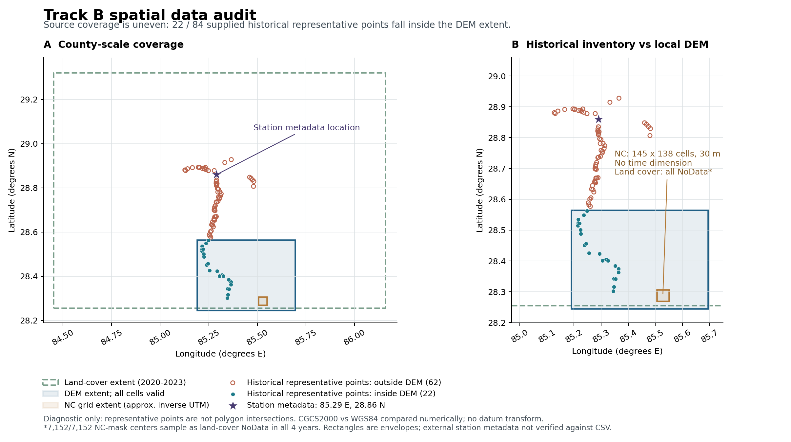

# 赛道 B 阶段 2：空间数据与历史清单审计

审计日期：2026-10-23（America/New_York）。范围为 `04_B赛道` 下的 03—08 数据目录。该报告记录可用性与限制，不包含模型训练、灾害机理判定或过程仿真。

## 1. 结论先行

1. **本地空间输入可读取，但覆盖范围和时间含义不能混用。** 全部 218 个文件已建清单；173 个 TIFF 的元数据及全部像元均完成读取；5 个 Shapefile 的全部记录头、包络及 DBF 字段完成扫描；1 个 NetCDF4 文件通过 h5py 完整读取。源文件逐一 SHA-256 复核无变化。
2. **高程变化率不是 168 份独立观测。** 共 56 个“瓦片×时期”来源组，每组包含 UTM 变化率、GCS 变化率、UTM 误差三份文件。UTM/GCS 是同一信号的投影版本，误差层是配套不确定性，不能将三者堆成独立样本。
3. **已有 DEM 仅覆盖历史灾害清单的一部分。** 84 个历史多边形中，23 个记录包络与 DEM 包络相交，17 个记录包络全部位于 DEM 内；属性提供的 84 个代表点中仅 22 个落在有效 DEM 格内。这个 DEM 不能支持全部历史多边形的地形特征提取。
4. **NC 中的表面速度是 2014—2024 年气候态，没有时间维。** 30 m 是当前网格间距；元数据明确注明速度经过双线性重采样，不能将其称为原生 30 m 动态监测，更不能当作 2026 年临灾前逐日加速序列。
5. **历史“灾点”实际是 84 个 PolygonZ 多边形清单，不是带发生时刻的事件序列。** 仅见 `解译Time` 和 `影像Time`；两者均不能直接用作泥石流发生时间。
6. **人口数据仅 1 个县级多边形。** `合计=17536` 与 `人口数=16155` 并存；没有村级、建筑物级或栅格人口，不能直接估计局部灾害范围内的受威胁人口。
7. **县域土地覆盖不能据外包络认定为源区可用。** NC 冰川正 mask 的全部 7152 个格中心，审计级 UTM 反算后在四年土地覆盖中均取到 0/NoData；200 km 缓冲区的中心属性点亦如此。应在正式坐标处理后复核，并补充实际覆盖源区的类别资料。

## 2. 审计覆盖及可复现方式

| 目录 | 文件数 | 总字节数 | 实际数据主体 |
|---|---:|---:|---|
| 03 冰川及表面高程变化 | 190 | 294,729,640 | 168 个 TIFF、3 套矢量数据、1 份说明 DOCX |
| 04 冰川地形、冰厚及表面速度 | 1 | 362,728 | 1 个 NetCDF4/HDF5 |
| 05 土地覆盖 | 4 | 100,431,132 | 2020—2023 年各 1 个 TIFF |
| 06 历史灾点 | 11 | 455,244 | 1 套矢量、XML 元数据、4 个遗留锁文件 |
| 07 DEM | 5 | 10,721,473 | DEM TIFF、world file、XML 与金字塔 |
| 08 第七次人口普查 | 7 | 52,735 | 1 套县级矢量 |
| **合计** | **218** | **406,752,952** | **173 TIFF、5 Shapefile、1 NetCDF** |

执行命令（仓库根目录）：

```bash
/usr/local/anaconda3/bin/python track_b/scripts/audit_spatial.py
```

本次使用现有 Anaconda Python 3.13.5，不安装依赖。TIFF 元数据由 tifffile 读取；缺少 imagecodecs 时，用现有 Pillow/libtiff 读取 LZW 像元。NetCDF4 的 xarray 打开尝试失败，异常已保存在 `netcdf.json`；h5py 成功读取全部 13 个数据集及属性。DBF、Shapefile 记录头和 DOCX 文本采用标准库解析。

审计产物位于 [`../audit/spatial/`](../audit/spatial/)：

| 产物 | 内容及使用方式 |
|---|---|
| `summary.json` | 总量、全像元读取成功数、投影计数、同源分组、文件名异常、源文件哈希复核结果 |
| `file_inventory.csv` | 218 个输入文件的路径、字节数和 SHA-256 |
| `rasters.json` / `rasters.csv` | 173 个 TIFF 的 CRS、分辨率、边界、NoData、完整像元统计 |
| `vectors.json` | 5 个矢量的类型、记录数、坐标系、边界及顶点数量 |
| `vector_attributes.json` | 全部 DBF 字段类型、缺失、值域、低基数类别统计与样例 |
| `*_attributes.csv` | 5 张完整属性表，保留原始字段和值，不修正可疑字段 |
| `*_geometry_envelopes.csv` | 全部矢量记录的包络与顶点数 |
| `*_representative_point_coverage.csv` | 属性代表点对 DEM / 各年土地覆盖的粗覆盖诊断 |
| `netcdf.json` | NetCDF 变量、单位、维度、属性、全单元统计、xarray 异常与 h5py 成功证据 |
| `dhdt_source_groups.json` | 56 个来源组与各投影/误差文件的对应关系 |
| `source_documentation.json` | DOCX 全部段落，以及 XML 中的流程和日期相关元素 |
| `coverage.json` | DEM、矢量包络、属性代表点、NC、外部站点元数据的诊断 |
| `spatial_coverage_diagnostic.png` | 无底图、英文标注的静态空间覆盖示意图，已视觉检查 |

**审计深度边界：** TIFF 像元和 DBF 字段是全量扫描；矢量仅扫描全记录头、包络、分部数及顶点数，未做拓扑合法性检查、真实多边形裁剪、面域面积计算或边界精确叠加。覆盖计数采用包络和原表代表点；历史清单 CGCS2000 与 WGS84 只作经纬数值层面的粗诊断，尚未实施基准转换。NC 的近似经纬边界由 UTM 反算级数生成，仅服务审计，不能替代正式 GIS 预处理。

## 3. 冰川边界及高程变化（03）

### 3.1 高程变化率 TIFF

- 14 个瓦片，4 个时期：2000—2005、2005—2010、2010—2015、2015—2020；合计 56 个来源组，各组的 3 个版本齐全。
- 56 个 UTM 变化率和 56 个 UTM 误差层：EPSG:32645（WGS84 / UTM 45N），网格间距 100 m。
- 56 个 GCS 变化率：EPSG:4326，角度网格间距约 0.00096136—0.00099041 度，不是固定长度单位网格。
- 全部为 float32，NoData 为 `-9999`，已排除 NoData 后统计有限值。UTM 变化率各瓦片/时期有效像元占比约 26.32%—78.07%；GCS 约 25.24%—74.83%。有效比例来自矩形网格，不等于冰川观测缺失率。
- UTM 变化率全局有限值范围约 -46.79—118.27；误差约 0.55—119.90。这里只记录值域，没有删极值或判断其物理合理性。
- **数值单位须与原产品说明核对。** 本地 DOCX 说明其为 Hugonnet 等产品的高程变化率及误差，但 TIFF 的 CRS 长度单位不能证明像元数值的时间单位。正式计算前应在来源字典中固定 `dh/dt` 单位、误差含义及误差置信水平。
- 文件名存在两处 `dhdt5`：`N27E086_2010-01-01_2015-01-01_dhdt5_UTM45_UTM45.tif` 及对应的 `_GCS.tif`。脚本用瓦片和日期分组，已将两者纳入正确来源组；原文件不改名，正式加载器应避免仅匹配 `_dhdt_` 而漏文件。

DOCX 明确记载：数据以坐标附近的目标冰川构建 200 km 区域，提取 RGI 6.0 / 7.0 边界和 Hugonnet 高程变化产品，并提供 UTM、GCS 与误差版本。这是“同源重复风险”的直接本地依据。

### 3.2 冰川及缓冲区矢量

| 数据 | 类型 | 记录数 | CRS | 重要时间字段 |
|---|---|---:|---|---|
| RGI V6 | Polygon | 3430 | WGS84 经纬度 | `BgnDate` 为 2000-10-30—2010-04-09；`EndDate` 全为 `-9999999` |
| RGI V7 | PolygonZ | 4337 | WGS84 经纬度 | `src_date` 为 1992-09-22—2010-06-10 |
| 200 km 缓冲区 | Polygon | 1 | WGS84 经纬度 | 无观测时间；属性中心点为 85.510299 E、28.293263 N |

RGI V6 和 V7 是不同版本的冰川清单，记录粒度、划分和字段存在差异。**版本号不能解释为后一个观测年份，也不能将两套记录直接相加当作 7767 个独立冰川。** `PolygonZ` 仅说明几何编码含 Z 通道，本审计未验证该通道的物理含义，不能将其视为独立实测高程。

## 4. 冰川地形、冰厚及速度（04）

文件名含 `Glacier-collapse and debris-flow disasters at Langtang Lirung, Nepal`。地理适用范围以内部坐标、投影和冰川 ID 为依据；仅凭文件名不能确定观测日期或目标冰川边界。

| 项目 | 审计结果 |
|---|---|
| 实际容器 | NetCDF4 / HDF5，CF-1.8 |
| 网格 | `y=138, x=145`，共 20010 个单元，网格间距 30 m × 30 m |
| CRS | EPSG:32645，UTM 45N |
| UTM 外缘 | x:353442.5—357792.5 m；y:3127917.5—3132057.5 m |
| 近似经纬外缘 | 85.505265—85.550125 E；28.269098—28.306935 N |
| 时间轴 | **无 time 维，只有 x/y 空间维** |
| `dem` | m，20010 格均有限，约 3551.77—6458.13 m |
| `slope` | degree，20010 格均有限，约 0.464—78.507 度 |
| `thickness` | m，7152 格有限，约 6—154 m；来源属性指向 Farinotti 等冰厚估计数据 |
| `vx, vy, v` | meter/year，7152 格有限；`v` 约 0.075—55.829 m/year |
| `vx_amp, vy_amp, v_amp` | meter/year，2014—2024 年速度季节振幅的气候态 |
| `glacier_mask` | 7152 格为 1，其余 12858 格为 NaN |

速度属性明确描述 **climatological [2014-2024]**，采用 2018-01-01 作为拟合截距时间；全球来源属性为 ITS_LIVE v2.1，并注明 `bilinear to the 30 m reference grid`。因此：

- 可作为长期运动背景或参数先验候选；必须明确与 2026 年事件的时间距离。
- 不能计算 2026 年灾前实际加速度，不能据此验证逐日/逐小时预警触发时刻。
- 不能把不同网格单元当作不同观测时间；季节振幅也不是已提供的逐月序列。
- 冰厚和速度 7152 格的有限值完全落在正值冰川 mask 内。网格外侧的 NaN 属于有明确空间掩膜背景的空值，不能直接算作“64.26% 数据缺失”。mask 内关键变量有限值为 7152/7152。

mask 引用的 `RGI60-15.04172`—`RGI60-15.04175` 四个 ID 均在本地 RGI V6 中找到。其属性面积合计 6.441 km²；mask 网格名义面积为 7152×30²=6.4368 km²。该检查支持来源关联，但不构成精确面域叠加验证，也不证明 DEM、冰厚、速度具有同一观测日期。完整字段记录见 `coverage.json`。

## 5. 土地覆盖（05）

2020、2021、2022、2023 四幅 TIFF 均为 3957×6336、uint8、EPSG:4326；外缘一致：84.450979—86.158497 E、28.255429—29.321819 N；角度间距约 0.000269494585 度。NoData=0，类别数值为 1—10；全部像元已按数值类别计数。

| 年份 | 有效类别像元 | 占矩形网格比例 | NoData 像元 |
|---|---:|---:|---:|
| 2020 | 11,205,116 | 44.6926% | 13,866,436 |
| 2021 | 11,201,571 | 44.6784% | 13,869,981 |
| 2022 | 11,203,017 | 44.6842% | 13,868,535 |
| 2023 | 11,203,175 | 44.6848% | 13,868,377 |

本地未发现分类代码的名称表、产品版本/来源说明或分类精度资料。正式分析前须取得图例，不能套用另一产品的 1—10 类别名称。类别代码没有连续量意义，脚本刻意不计算类别代码的均值/分位数。NoData 可能包含行政区裁剪掩膜等范围外单元；本次未栅格化县界做核验，不能把约 55.3% 的矩形空白直接解释为遥感观测缺失。

进一步检查有效类别而不是矩形范围：历史 84 个代表点在每一年均只有 83 个取得非 0 类别；`Q4XM-JLH-D00234` 的代表点（85.345222763 E、28.302233166 N）四年均为 0。200 km 缓冲区中心点（85.510299 E、28.293263 N）及 NC 全部 7152 个正 mask 格中心，四年均采到 0。NC 格中心采用 UTM 逆算级数作粗定位和所落类别格采样，没有正式基准转换和面域叠加；此结果是明确的补数线索，不能借重投影或插值创造不存在的类别信息。

## 6. 历史灾害清单（06）

实际几何类型为 PolygonZ，84 条记录、33 个属性字段，CRS 名称为 CGCS2000（由 WKT 名称识别为 EPSG:4490）。整体几何外缘约 85.008211—85.481925 E、28.260450—29.004932 N。

日期字段的完整统计为：

- `解译Time`：84/84 均为 **2020-07-25**。
- `影像Time`：2010-05-08（4 条）、2014-12-28（4 条）、2015-05-08（23 条）、2015-05-13（6 条）、2017-10-10（31 条）、2017-10-17（3 条）、2017-11-11（13 条）。
- 未发现明确的灾害发生日期、开始时刻、结束时刻或逐次事件 ID。唯一的 `Code` 有 84 个，但唯一编码并不证明每条记录是一个有发生时刻的独立事件。
- XML 的创建/修改/同步日期为 2026 年 8 月，流程记录包含 `CalculateField ... 解译Time ...` 与 `影像Time ...`。这些是数据制作或更新证据，不能覆盖原字段含义、也不能用作灾害发生时刻。

可用类别字段包括：类型（降雨型 41、冰水混合型 25、冰雪融水型 16、冰湖溃决型 2）、规模（小 30、中 45、大 7、特大 2）、频率（高 37、中 26、低 21）。这些可以描述清单构成，不能充当逐时发生概率或按年份统计事件频次的真值。

必须保留的字段质量疑点：

- `影像类` 全为 `Google earth`，`影像type` 全为 `1m`，而名为 `Resolution` 的字段为 `吉隆河`（77）或空（7）；疑似字段命名或填表错置。审计保留原值，没有重命名或“修复”。
- `承灾体` 54/84 为空；不能将空值解释为没有承灾体。
- `II水系`、`III水系` 均全部空；`I水系` 77/84 为空。
- `height` 与 `沟口H` 的数值在 84/84 条完全一致，正式特征构建时应检查重复量，避免重复解释同一地形信号。
- `扇宽` 和 `扇长` 各有 31 条为 0，同时 `有无_Fan` 有 31 条为“无”。0 可能表示结构性不适用，须先定义缺失/不适用口径再做标准化。
- 长度、面积、断层距离等属性缺少本地字段单位字典；不能仅依据数值大小确定单位。

**对前两问的影响：** 现有清单适合作为空间地貌/灾害类型背景与候选空间样本，尚不支持将其与 2021—2026 年气象时序按真实事件时刻配对。若要做气象因子监督排序、阈值验证或预报覆盖率检验，必须补充有可信发生时刻的事件与非事件观测。

## 7. DEM（07）

DEM 为 1148×1816、float32、EPSG:4326；外缘为 85.189755775—85.694143817 E、28.245534510—28.564382285 N；角度间距约 0.000277746719×0.000277741964 度。标记 NoData=-32767，但实际 2,084,768 格均为有限值且无该 NoData；高程范围约 1620.91—7254.48 m。

GeoTIFF 中垂直单位为 metre，但垂直参考系/基准名称为 unknown。XML 的处理记录是从 `GeBainiDEM_30M.tif` 裁剪，时间属性为 2026-08-26。**目录名和裁剪创建日期不能确定原始 DEM 的测量日期，也不能证明是事件前/事件后地形。** 源 DEM 产品、测量年代、垂直基准及可能的误差需要补齐。

正式坡度、水流方向、距离、面积及流动仿真计算应在合适的米制投影中处理；经纬度格网不能直接按“像元=固定 30 m”实施这些计算。本次没有重投影或生成坡度/水系等派生数据。

## 8. 人口普查（08）

1 个县级 Polygon、27 个 DBF 字段，UTF-8 编码、WGS84 经纬度。县级区划码为 540234，县名为吉隆县。`合计=17536`，且男 9338 + 女 8198 = 17536；城镇 5015 + 乡村 12521 = 17536。另有 `人口数=16155`、户数 4845、户规模 3.33。

这些内部关系提示不同字段可能属于不同普查口径，但本地缺少字典；**不能据此确认 `人口数` 一定是家庭户人口，也不能擅自把 16155 改成 17536。** 此处仅记录原值及待核事项。

该文件可以支持县级背景说明或县域总量约束候选。局部暴露分析若只按面积比例均摊县域人口，会引入未验证的人口空间分布假设。需要村/居民点位置、建筑物、道路及更细人口资料，并记录数据年份与不确定性。

## 9. 覆盖交集与空间尺度口径

下表为完整记录包络/代表点扫描，**不是精确多边形交集结果**：

| 数据 | 总记录 | 包络与 DEM 相交 | 包络完全落入 DEM | 属性代表点在有效 DEM 格内 |
|---|---:|---:|---:|---:|
| RGI V6 | 3430 | 212 | 174 | 197 / 3430 |
| RGI V7 | 4337 | 293 | 249 | 274 / 4337 |
| 历史清单 | 84 | 23 | 17 | 22 / 84 |
| 县级人口 | 1 | 1 | 0 | 不适用 |

NC 的近似外缘全部落在 DEM 外缘内。这个判断只说明范围兼容，不说明 NC 和 DEM 的高程、采集时间或垂直基准一致。土地覆盖的矩形范围与所有 84 个历史清单包络相交，但每年仅 83/84 个代表点有类别值；NC 冰川正 mask 的 7152 个格中心，四年均无有效类别值。不能从矩形相交推出类别可用。



AI辅助贡献：本审计脚本、统计表和上述可视化由OpenAI Codex辅助生成并进行程序及代理复核；具体模型版本待队员补齐，人工采用/修改记录见[AI_USAGE](../AI_USAGE.md)。

图中星标为外部站点目录所列坐标（85.29 E、28.86 N），位于当前 DEM 之外。来源为[目录镜像](https://gwfnet.net/Metadata/Index/T-2026-08-28-p1f3e5qIqTEyibfPAp3smBeA)，其链接指向 [TPDC 数据集](https://www.tpdc.ac.cn/zh-hans/data/5b09afd1-d11b-4150-a291-50f0484dddf1)（DOI: 10.11888/Atmos.tpdc.303600）。镜像信息与本地 CSV 版本尚未做哈希一致性验证，CSV 本身不能独立证明站点坐标。这一证据提示需要站点代表性检查，不能据此直接建立站点至冰川源区的精确气象传递关系。

空间分析应分别维护“区域背景范围”“历史清单样本范围”“源区参数网格”“局部过程 DEM 范围”，并在每次叠加时记录实际交集、掩膜、坐标变换和样本保留数量；不能将它们当作覆盖一致的同一研究范围。

## 10. 正式分析前的空间数据验收项

| 优先级 | 需补齐/确认 | 验收证据 |
|---|---|---|
| P0 | 事件标签：发生日期、时刻、持续时间及地点/范围；区分历史易发地貌与实际事件 | 独立来源与定位依据、时间精度、可与气象数据配对的字段 |
| P0 | 模型的空间对象与范围：源区、沟道、下游保护点、区域背景 | 统一 CRS 后的目标边界、范围交集与覆盖表 |
| P0 | DEM 的产品、观测年代、事件前后属性、垂直基准 | 来源元数据；确定适用范围及误差处理口径 |
| P0 | 过程验证资料：到达时间、路径、冲淤/堆积边界、体积或流量的可追溯观测 | 可用于验证且明确独立性的观测记录 |
| P1 | 历史字段单位与可疑字段说明、各类型清单来源 | 字典、原资料及原值到清洗值映射；禁止默改 |
| P1 | 土地覆盖分类图例、产品版本与精度、NoData 掩膜含义，以及源区有效类别补数 | 官方产品说明、类别代码映射、对 NC 冰川 mask 有效范围的正式复核 |
| P1 | 冰厚及速度产品的原始时空尺度与适用性 | 版本、观测/拟合时期、重采样过程与不确定性 |
| P1 | 局部人口/居民点/建筑物/道路暴露资料及普查字段口径 | 足够细的空间单元、年份、与县域总量关系 |
| P2 | 完整 GIS 环境与正式预处理 | 可重建依赖清单、CRS 转换、精确几何叠加、分类最近邻重采样等记录 |

目前可开始来源追溯、字段口径确定、目标范围核对和环境最小闭环；以上 P0 缺口影响验证和结论可信度，不能用“模型可以运行”替代验收。该清单不预先决定最终算法或仿真方案。
