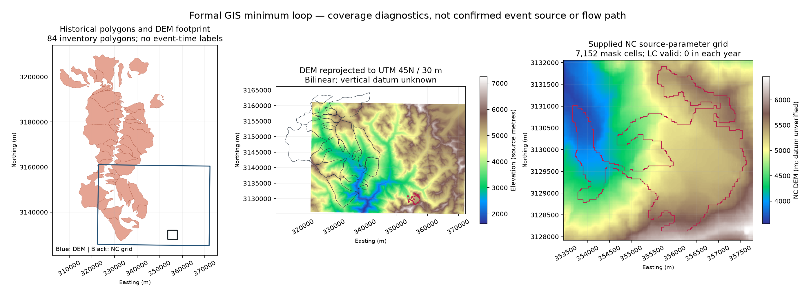

# 阶段 3 E04：正式 GIS 最小闭环与覆盖复核

日期：2026-10-23（America/New_York）。本工作包完成正式 GIS 读取、水平坐标转换、像元与面域覆盖复核及小型派生成果。尚未确认事件源区、口岸保护点或全传播沟道，也没有生成触发模型、坡度模型、河网或泥石流仿真。

## 1. 当前可采用的结论

1. **GIS 读取和派生链已跑通。** 5 套 Shapefile 的全部要素、DEM、四年土地覆盖和 NetCDF4 均已通过正式工具读取。形成 8 份 GeoTIFF、1 个四图层 GeoPackage、覆盖表、坐标操作记录、参数及输入/输出哈希。
2. **NC 参数网格有本地 DEM 支持，但两份高程存在明显差异。** NC 全部 20,010 格及正 mask 的 7,152 格均被原 DEM 有效足迹覆盖；独立 DEM 双线性采样至 NC 格网后，mask 内“独立 DEM − NC DEM”均值为 **−30.74 m**，范围 **−80.49—109.37 m**。两份产品的来源、年代和垂直基准未统一，不能直接拼接或把差值解释为真实高程变化。
3. **土地覆盖缺口被正式转换再次确认。** 正 mask 全部 7,152 个格中心，在 2020—2023 年四份土地覆盖中均位于栅格矩形内，但均取到 **0/NoData**。最近邻投影到 NC 格网后，mask 内有效类别同样为 0。重投影不能补出源区类别。
4. **84 个历史多边形中，23 个与 DEM 有正面积交叠，17 个完全落入 DEM 足迹。** 23 个面域内都存在有效 DEM 像元。这与阶段 2 的“22 个属性代表点有 DEM 值”不冲突：点样本与整个多边形的覆盖定义不同。
5. **CGCS2000 到 WGS84 仍只有 ballpark 操作。** 当前 PROJ 数据库未提供可用的非 ballpark 操作，报告精度为 −1（未知）。以下几何统计是在这一水平转换条件下的覆盖诊断，不能支持测绘级边界精度。
6. **源区到口岸的地形连续性仍未验收。** NC mask 是四个 RGI 冰川的参数网格，不是已核实的实际失稳面。缺少可追溯的口岸保护点坐标及沿河中心线，本轮没有猜测端点或用直线连接代替沟道。

机器事实见 [`pipeline_report.json`](../data/processed/spatial/pipeline_report.json)，处理口径见 [`spatial_policy.json`](../config/spatial_policy.json)。

## 2. 运行与输入保护

从仓库根目录执行：

```bash
track_b/.venv/bin/python -u track_b/scripts/prepare_spatial.py
```

脚本为 [`prepare_spatial.py`](../scripts/prepare_spatial.py)。环境由主工作包创建，实际版本包括 Python 3.12、rasterio 1.5.2、pyproj 3.8.0、GeoPandas 1.2.0、Shapely 2.2.0、xarray 2026.9.0 和 h5netcdf 1.8.1；精确版本以报告 `software` 为准。

原始资料只读，派生成果全部写入 `track_b/data/processed/spatial/`。输入清单包括实际读取的 5 套矢量主体与坐标/编码侧文件、DEM 及其侧文件、4 份土地覆盖、1 份 NC，以及处理脚本和策略。源哈希在读入前登记、运行结束再次比对；本轮全部一致。输入哈希证明本地文件未被处理改写，不能代替产品官方认证。

脚本可重复运行并覆盖自己的派生文件。GeoPackage 内部时间戳等元数据可能使两次运行的字节哈希不同；本轮 `output_manifest.json` 负责校验同一次交付，不承诺 SQLite 文件逐字节确定性。

## 3. 坐标、几何与面积口径

工作坐标系采用 **EPSG:32645（WGS84 / UTM 45N）候选**，使用米作为平面长度单位。历史清单、NC 和局部 DEM 处于本地适用区域；200 km 背景数据向西超出 UTM 45N 标准分区，本轮没有使用全部区域冰川的投影面积作跨区精确比较。

坐标操作统一 `always_xy=True`：经纬输入/输出始终按经度、纬度传递，避免 EPSG 地理坐标定义的纬度、经度轴序引起交换。每个操作记录来源/目标 WKT、实际 pipeline、报告精度、ballpark 标志、非 ballpark 操作数以及不可用网格；见 [`coordinate_operations.json`](../data/processed/spatial/coordinate_operations.json)。

| 操作 | 本轮状态 | 用途与限制 |
|---|---|---|
| WGS84 经纬 → UTM 45N | 正常投影；无 ballpark datum 操作 | 区域转局部米制坐标；操作报告 −1 不能解释为零误差 |
| CGCS2000 经纬 → WGS84 经纬 | ballpark，精度未知；无可用非 ballpark 操作 | 显式能力探测，记录基准转换限制 |
| CGCS2000 经纬 → UTM 45N | ballpark 地理偏移加 UTM 投影 | 历史多边形粗至中尺度覆盖诊断；精度需求更高时须补可验证转换依据 |
| UTM 45N → WGS84 经纬 | 正常逆投影 | 从 NC 格中心定位原始 DEM/土地覆盖像元 |

**面积算法：** 在原始地理坐标中的边段先加密至最大约 `0.000277746719°`，再投影；Shapely 在投影平面执行真实多边形交集并以 m² 计面积。DEM 足迹使用栅格真实外缘，另从原始有效像元掩膜生成有效足迹，二者分开。这里的“精确交集”是相对于这一离散边界表达的平面几何运算，并不消除原始边界误差、datum 不确定性或曲线近似误差。

所有平面分析副本去掉 Z；原文件及 Z 通道保持原样，未给 Z 赋予未经核实的实测高程含义。形式化拓扑检查结果为：

| 数据 | 要素数 | 原始无效几何 | 投影后修复前无效 | 派生最终无效 |
|---|---:|---:|---:|---:|
| 200 km 缓冲区 | 1 | 0 | 0 | 0 |
| RGI V6 | 3,430 | 2 | 0 | 0 |
| RGI V7 | 4,337 | 0 | 16 | 0 |
| 历史多边形 | 84 | 0 | 0 | 0 |
| 县级人口边界 | 1 | 0 | 0 | 0 |

修复仅用 `make_valid` 作用于派生 2D 副本；原始 2 条 RGI V6 的索引、原因及投影后 16 条 RGI V7 的索引、原因均保留在机器报告。RGI V7 的投影后修复最大绝对面积改变量约 `0.000023 m²`。这是数值拓扑处理记录，不是重新解译冰川边界。

## 4. DEM 与历史多边形覆盖

原 DEM 为 EPSG:4326，1,148×1,816；**2,084,768/2,084,768** 格有效，原始 NoData 标记 −32767 没有实际出现。像元角度大小约 `0.000277746719°×0.000277741964°`；不能直接把经纬像元作等距 30 m 单元进行距离和水流计算。

本轮以 bilinear 重采样输出 30 m UTM 候选网格，大小 1,199×1,663，NoData=−9999。1,940,245/1,993,937 格有效；外围 53,692 个 NoData 由目标矩形包含旋转/曲边投影后的源范围外部分造成，不能解释为原始 DEM 出现了同数量的内部观测缺失。目标网格 30 m 不代表原始地形分辨率提高。

高程数值的单位保留为原元数据的 metre；**垂直基准、原产品和观测年代仍未知**。没有执行垂直基准转换、凹地填平、河道烧入或坡度/汇流计算，不能把输出称为经过水文校正的地形。

历史清单逐要素结果在 [`history_dem_coverage.csv`](../data/processed/spatial/history_dem_coverage.csv)：

| 指标 | 数量/面积 | 含义 |
|---|---:|---|
| 总多边形 | 84 | 空间清单记录数，非已证明的独立时序事件数 |
| 与 DEM 外足迹相交 | 23 | 真实几何交集而非包络交集 |
| 与 DEM 正面积交叠 | 23 | 本轮未出现仅碰边而无正面积的情况 |
| 完全被 DEM 外足迹覆盖 | 17 | 面域完整覆盖 |
| 面域内有原 DEM 有效格中心 | 23 | `all_touched=False` 原格网支持 |
| 面域触及原 DEM 有效像元 | 23 | `all_touched=True` 原格网支持 |
| 全部历史多边形并集面积 | 1,382.259 km² | 去掉多边形相互重叠后的平面面积 |
| 历史并集与 DEM 有效足迹交集面积 | 339.675 km² | 只说明面域支持，不能替代每个记录覆盖率 |

表中“像元数量”与“精确面积”分别计算，像元中心/触及判定不被称为精确面域面积。每条记录保存完整面积、交集面积、覆盖比例以及两种原格网支持数；先前代表点覆盖 22 条继续保留其自身定义。

## 5. NetCDF4 CF 解码与源区参数网格

使用 `xarray.open_dataset(engine="h5netcdf", decode_cf=True, mask_and_scale=True, decode_coords="all")` 正式打开 CF-1.8 文件，同时以关闭解码方式读一份作对照。`spatial_ref` 被正确识别为坐标；读取 CRS WKT 为 EPSG:32645。该操作说明文件可按本次参数解码，不代表已通过全面 CF 一致性认证。

网格为 y=138、x=145，间距30 m；原始 x 递增、y 递减。导出按北向上的 GeoTIFF 方向，数组与坐标一起排序，并回读检查首格中心坐标及全部 NC DEM 像元相等；没有上下翻转。GDAL 仿射变换为：

```text
[353442.5, 30.0, 0.0, 3132057.5, 0.0, -30.0]
```

10 个二维变量在解码前后均逐元素相等（将 NaN 等价处理）；原数值没有因未预期的 scale/offset 改变。正 glacier mask 为 **7,152 格、6.4368 km²**；dem、slope、thickness、vx、vy、v 等在 mask 内的有限值数与阶段 2 一致。文件仍无 time 维，速度仍是 2014—2024 气候态；正式解码没有创造事件前的动态观测。

独立 DEM 对 NC 全格网和正 mask 的有效覆盖均为完整；以下差值只是数据兼容性诊断：

| 比较范围 | 有效格数 | DEM−NC DEM 最小值 | 最大值 | 均值 |
|---|---:|---:|---:|---:|
| 全 NC 格网 | 20,010 | −231.82 m | 573.44 m | −13.53 m |
| 正 glacier mask | 7,152 | −80.49 m | 109.37 m | −30.74 m |

差异可能同时包括产品、采集年代、基准、网格分辨率和插值等因素；本轮没有将其归因于某一个因素，也没有计算并宣称某一 DEM 更准确。正式坡度、物源体积或传播参数分析前，须先决定使用哪个高程基底并给出来源和误差依据。

## 6. 土地覆盖正式复核

对四个年份分别将全部正 mask 格中心通过 pyproj 正式逆投影至原土地覆盖 CRS，读取其所在原格；再用 **nearest** 重投影至 NC 网格交叉核对。分类码保留数值，不套用尚未取得的类别名称。

| 年份 | mask 格中心数 | 在土地覆盖矩形内 | 原格有效类别 | 最近邻导出后 mask 有效类别 |
|---|---:|---:|---:|---:|
| 2020 | 7,152 | 7,152 | 0 | 0 |
| 2021 | 7,152 | 7,152 | 0 | 0 |
| 2022 | 7,152 | 7,152 | 0 | 0 |
| 2023 | 7,152 | 7,152 | 0 | 0 |

所有样本值均为 0，等于源 NoData。这里是 NC mask 参数域的检查，不是已核实事件失稳面的土地覆盖统计。需要能够实际覆盖跨境源区的同产品/可比产品资料、官方图例及产品精度说明；bilinear 不适用于这些类别码。

## 7. 已验证的地形范围与仍需补充的沟道证据

目前可确认的是：原 DEM 矩形内部没有 NoData，NC 全部参数网格与冰川 mask 在其有效范围内。不能据此确认源区下游沿沟到口岸的整个路线都在 DEM 里，也不能确认其中不存在水文伪地形。

继续验收需要四类具体输入：

1. **事件实际失稳面多边形**：来源、观测时间和定位误差，独立于多年 RGI 参数 mask。
2. **目标口岸保护点**：明确设施/桥位/断面的点或面坐标、坐标系、来源及位置不确定度；仅用地名无法验收。
3. **沿河中心线及走廊宽度**：优先有出处的河网或影像核验线；若由 DEM 提取，需单独记录水文处理与人工核对，再检查整条缓冲走廊的有效像元、边界余量和沿线高程。
4. **DEM 来源及垂直信息**：产品、采集年代、事件前后属性、垂直基准、分辨率与误差，解释与 NC DEM 的差异并固定后续高程基底。

本轮 `source_to_port_continuity_verified=false`，并未输出臆造口岸点、沿河距离、流速或到达时间。

## 8. 交付与验收

| 产物 | 内容 |
|---|---|
| `dem_utm45_30m.tif` | 独立 DEM 的米制 bilinear 候选副本 |
| `dem_on_nc_grid.tif` | 独立 DEM bilinear 采样至 NC 原网格，用于可比性诊断 |
| `nc_dem_native_grid.tif` / `nc_glacier_mask.tif` | NC 数值/掩膜直接导出，坐标方向已核查 |
| `jilong_LUCD_2020—2023_nc_grid_nearest.tif` | 四年分类最近邻小样，保留 NoData |
| `spatial_diagnostic.gpkg` | 历史清单及覆盖列、县界、NC 邻近 RGI6、四种覆盖足迹；全部2D EPSG:32645 |
| `pipeline_report.json` | 版本、全要素拓扑检查、CF 解码、栅格元数据、覆盖统计、读回与原始哈希检查 |
| `source_manifest.json` / `output_manifest.json` | 本轮输入/输出哈希；前者包括参数和脚本 |
| `coordinate_operations.json` | CRS、轴序、datum 操作、精度与 ballpark 限制 |
| `spatial_pipeline_qa.png` | 三面板的正式处理核查图 |
| `visual_review.json` | 对具体图像 SHA-256 的独立视觉检查记录 |

全部 8 份输出 TIFF 均已重新打开读取并核对 CRS；GeoPackage 四个图层均已重新打开，数量与几何有效性通过。NC DEM 和 mask 导出还与内存源数值逐像元比较，格中心坐标通过。原始哈希检查通过。核查图已由 Codex 实际查看，标签、颜色条与边界可辨，无图层镜像或上下翻转迹象；这不构成真实事件地理定位核验。

独立复核发现初版图最左侧 Northing 轴标签被画布裁切，已使用 `bbox_inches="tight"` 和显式留白修复并重新查看。此次仅从既有空间文件重绘同一绘图代码段，8 份 TIFF、GeoPackage 与覆盖 CSV 哈希均未改变；脚本、图像、视觉记录及关联清单已刷新，修图说明见报告 `verification.figure_render_repair`。



AI 辅助贡献：策略、脚本、统计与图由 OpenAI Codex 辅助生成并完成程序和视觉检查；队员仍须独立核验地理证据、参数取舍和最终采用/修改，记录于 [AI_USAGE](../AI_USAGE.md)。本工作包不替代队员核心模型与算法工作。
