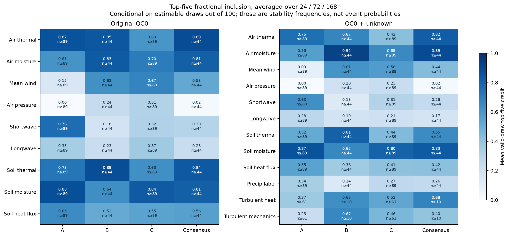
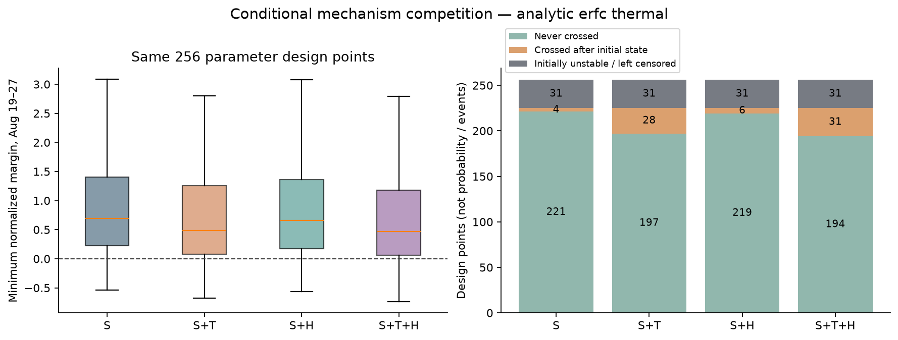
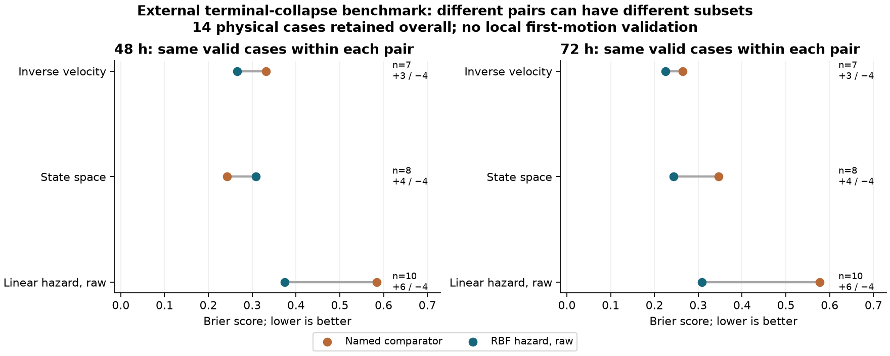
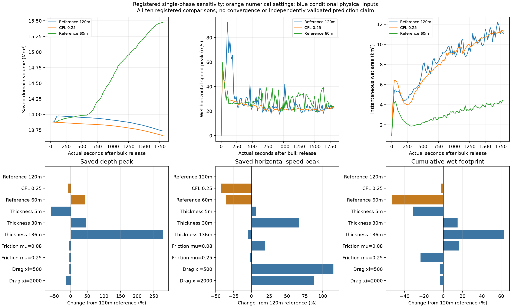

# 阶段4第三轮联合审查（Q1/Q2及Q3主研究已集成，传播耦合收尾中）

本轮已执行完整本地模型研究。Q1、Q2及Q3三引擎主研究已提交、独立复核并集成；Q4仍在正式竞争，Q3待其映射传播增量，当前文件不表示第三轮已经全部验收。队员最终科学采用仍待联合评审。授权范围见[第三轮工作流](18_stage4_round3_workflow.md)。

## 共同起点与可复查入口

共同基线为`904d7257b899b9f71d1ac9e0eab7479e459eab52`，准备提交为`de790034cf302de58e69329dbe288aad269a359c`。725项输入冻结，300份前两轮研究/审计文件保留原字节；历史共享工具按对应提交恢复审计。30项轮次隔离测试和四窗五组启动检查通过。完整来源/集成提交/缓存范围见[四窗登记](../audit/stage4/round3/workspaces.json)，各问复跑命令随研究包保存。

原44包环境保留。Linux模型在本地Docker运行，固定r.avaflow4.0 Rev7、D-Claw1.0.0和Clawpack5.11.0源码；运行时[原版证据](../audit/stage4/round3/runtime/advisor_snapshot.json)和[resourcefix1派生证据](../audit/stage4/round3/runtime_resourcefix1/advisor_snapshot.json)分开保存。派生版仅替换最终45处资源清理调用；有效配置下70项共同输出逐字一致，633份诊断缓存逐项验哈希。这是资源修复回归，不是新增灾害验证。

研究分为本地描述证据、外部迁移评价、条件情景和数值基准四层。层级不同的分数不合并排名；重复小时、参数设计点、监测传感器和目标设施均不自动增加独立事件数。

## Q1：因素族候选与方法分歧

[模型竞争](../research/q1/round3/MODEL_COMPARISON.md) · [完整交接](../research/q1/round3/HANDOFF.md) · [复跑](../research/q1/round3/REPRODUCE.md) · [因素方向](../research/q1/round3/results/factor_directions.csv)

实际构建5526窗口样本、24驱动、112特征，按2021—2025年和过程代理等权；保留24/72/168小时、QC0/unknown两轨、真正改变小时集合的±1小时与对照敏感性。300折训练/评价支持经独立复核无168小时重叠。QC主轨三路线跨窗候选为：

| 路线 | TOP5候选（名次顺序） | 解释用途 |
|---|---|---|
| 边际加权ECDF | 土壤水分；空气热状态/短波辐射并列；土壤热通量；空气湿状态 | 可解释异常底座 |
| 收缩协方差条件贡献 | 土壤热状态、空气湿状态、空气热状态、平均风场、土壤水分 | 共线和冗余挑战 |
| 相似天气过程 | 土壤水分、平均风场、空气湿状态、土壤热状态、空气热状态 | 背景选择挑战 |

预登记三路共识如下；频率均条件于可估计draw，不能读作致灾概率。

| 因素族 | 共识分数 | 跨窗平均入选频率 | 每窗有效共识draw/请求100次 |
|---|---:|---:|---:|
| 土壤水分 | 0.7431 | 0.8144 | 44/100 |
| 空气湿状态 | 0.6667 | 0.8144 | 44/100 |
| 土壤热状态 | 0.6389 | 0.8434 | 44/100 |
| 空气热状态 | 0.6111 | 0.8902 | 44/100 |
| 平均风场 | 0.5833 | 0.5265 | 44/100 |

100次原始层级抽样全部保留，没有重抽凑数；56次少于4个唯一年份，B及共识相应不可估计。候补土壤热通量频率0.5593高于风场，故第五席不稳固。保留共识候选作为主表，A作为解释底座，B/C作为挑战；不能由同一个案异常分选择“预测冠军”。QC主特征实际5年，unknown湿族4—5年、通量4年且部分B校准0年，实际有效年数不能用名义5年代替。

土壤水分的状态与变化方向必须分开：0.1m含水率在168小时内从0.1647降至0.08275m³/m³，趋势−0.01222/24h；窗口中位仍处于季节背景约82.22%位。它支持“较高背景位置且近期下降”，不支持直接写成持续增湿或源区孔压上升。FLUX处理、小时区间和部分质量仍unknown，降水标签不等于累计雨量。独立本地灾害训练/验证均0，当前结果属于区域站个案关联。

[Q1集成复核](../audit/stage4/round3/q1_integration_check.json)：37项直接输入、79项稳定输出与源工作树一致；630组稳定性及路线/推荐重算一致，300折无支持交叠。

## Q2：结构—温度—水竞争与数值参考

[模型竞争](../research/q2/round3/MODEL_COMPARISON.md) · [完整交接](../research/q2/round3/HANDOFF.md) · [解析热方法](../research/q2/round3/ANALYTIC_THERMAL.md) · [复跑](../research/q2/round3/REPRODUCE.md)

同256个19维参数设计点、4机制、2强度策略实际完成每版2048情景。S为共同结构/损伤基础，T为内部导热/温度强度路径，H为储排水/孔压路径；H的融水边界与T的深层传热不同。正裕度表示稳定，初始已不稳标左删失，未越阈保留。

| 线性强度分支，每行256设计点 | 后续越阈 | 初始左删失 | 未越阈 | 评估期最小裕度中位（FD v2） |
|---|---:|---:|---:|---:|
| S | 4 | 31 | 221 | 0.6901 |
| S+T | 28 | 31 | 197 | 0.4849 |
| S+H | 6 | 31 | 219 | 0.6623 |
| S+T+H | 31 | 31 | 194 | 0.4714 |

这些是设计点计数，不是事件概率或真实命中。主方法推荐共同参数的四组竞争框架，STH为统一计算引擎；S必留，ST/SH及暖端岩接触保留挑战，现有观测不能确认唯一机制。临界水头保留负根、不可达和无压力单独根；以热扩散率α=1.5×10⁻⁶m²/s为例，72小时纯导热的“界面温变/地表阶跃幅度”无量纲响应在2m约0.0233、5m约1.43e−8，不能由短期暖站温直接推断深层快速失强，也不排除水热平流或既有多年初态。

全参数热网格比较发现，类别一致仍可伴随较大首过阈时间差，因而追加并全量完成解析erfc因果卷积路线。解析全2048情景为137有限越阈、248左删失、1663未越阈；137有限配对中，解析对0.0625m参考最大启动差0.34708小时，对0.125m v2为19.07238小时。注册线性传热域内优先用解析模块作温度数值参考，保留FD版本对照。它不消除小时水/损伤离散、不连续暖端强度或材料/初态误差；温度解析精度不能包装成整体预报精度。

新文献组分对照保留旧设计，另积分128条情景。rock=0.85/0.90仅通过均质密度干预，其有限时刻中位较旧代表提前约218/235小时，显示参数域选择的影响远大于小数精度；这不是当地组成反演。可辨识性基准中，单裕度/重复裕度/+T/+压力/+理想D的秩依次1/1/2/3/4，温压、损伤和强度存在补偿。

补取3对真实SAR速度产品，局地中位27/26/28m/年，产品误差48/55/52m/年，不能辨识临灾加速，也不能证明没有加速。Mamot所采用强度关系的材料、−8至−0.5°C、100—400kPa及快速剪切适用域已核读；整套实验另含部分800kPa测试，不能将其自动纳入该公式拟合域。当地材料和慢蠕变迁移仍未知。

后续定向补证实际读取官方补充表141条试验和14条作者派生摘要，二者分开。名义800kPa组20条，面积修正后法向应力808.89—868.63kPa，仅有−4至−0.5°C名义暖温层，实测温度为−4.1至−0.3°C；名义400组实际最高525.29kPa，名义分组与连续拟合域不能混用。标签spec1—spec8缺少已核物理试件UID，重复结构保留未知。新竞争在四域、两权重下共576留组折，其中五暖温层全应力域83条试验对应两权重136折。该域row-OLS温度线性MC训练RMSE为187.45kPa，整温层/整应力留出的按留出组等权宏平均RMSE约198.41/296.34kPa；应力二次与400铰链训练误差更低，但只留800组误差约925.78/2065.13kPa，不能据训练拟合采用复杂应力关系。作者固定Eq6仅作描述复核，作者筛温流程未作为独立CV结果。建议保留低复杂度暖高应力关系为外部本构挑战，暂不替换Q2/Q3已有关系；800组也不等于现场有效应力、材料、速率和孔压迁移均已验证。原7份接口与220核心输出保持原字节，[新增实验研究](../research/q2/round3/lab_strength/REPORT.md)的9输入/113输出及116个新增Git文件已逐项验包，见[集成核对](../audit/stage4/round3/q2_lab_integration_check.json)。

[Q2集成复核](../audit/stage4/round3/q2_integration_check.json)：60项直接输入、220项稳定输出一致；7份版本化机制/释放/数值/组成接口保留原字节。全候选源mask释放体积16.477—51.756Mm³为条件指定，双网格按同体积归一，不能称实测释放面。

## Q3：时间预测与外部评价（最终耦合待收尾）

[模型竞争](../research/q3/round3/MODEL_COMPARISON.md) · [完整交接](../research/q3/round3/HANDOFF.md) · [复跑](../research/q3/round3/REPRODUCE.md) · [题意对照](../research/q3/round3/REQUIREMENTS_MAP.md)

A机制首次过阈、B逆速度/状态空间、C动态风险均已有真实计算。A使用完整2048情景，64代表仅核状态；真实历史可用、假设延迟与理想天气分开。本地启动真值及首次天气可用时间仍未知，严格历史业务轨不认证。单一离散情景支撑造成零宽条件区间时，不能宣称高精度。

外部主评价为13独立终末失稳组，另1个真实右删失站进入C风险集。B固定提前24小时发布72小时预测的全标签包含为IV3/13、SS6/13；不把弃权删去。共同锚点252行、14组×3时域×6模型的配对已经独立复算，但部分标签上界恰等于时域末端，连续条件分位无法包含该上界，故该表完整覆盖0受锚点设计影响。不能据此单独论证一般校准失败，也不能把相交当95%覆盖。

同8组共同有效机会，48小时B_SS Brier0.24289优于无记录年龄RBF raw0.30883；72小时RBF0.24340优于B_SS0.34692。原生/小时发布尺度也会反转排名。主建议按观测条件分工，保留模型集合；小样本共形需要的秩超出校准组数时明确无界，不截断成有限95%保证。

50分钟KKN真实波形和USGS54条人工拾取阶段证据已取得；单站频带候选异常、目录原点误差都不足以接受源区首次机械启动真值。原通用释放早包没有Q2父映射，42条目标记录正确拒绝硬配。新增映射v2已通过独立接口复核：14条记录完整关联2个物理情景、7个候选点，20个物理参数逐项保持；原几何、映射几何和完整源面仍分别登记。两例的原生质量残差为+21.3729%/+12.7163%，且源区在60m网格欠分辨，全部不获到达包络资格。唯一原始命中为p0036到河道候选汇入口，假设整体释放后(1360.5,1380.1]秒；p0000父情景未启动，保留if-released。启动到整体释放延迟仍未知，绝对到达和合格传播时延不输出。最终完整源面增量另待交接。现有两例在请求1800秒内的实际存帧、h≥0.1m足迹为2.5704/4.3416km²；受影响格心到正释放栅格支持并集的最大欧氏距离为5.602/6.670km。该距离定义不同于沿河程、质心距离或警戒半径，欠分辨和质量缺口同样适用，未认证为预警距离。

解析天气回放实际完成75次发布×10天气轨×2048情景，共153.6万参数结果、60,750分布、20,250范围。独立实读全部参数结果未见未来历史时刻泄漏或左删失伪精确。96条同72小时随访状态对照的最大温差2.78954°C、裕度差1.07956、压力差40.86915kPa；17,280个可判GFS—ideal概率配对差为0。当前预测窗内342个跨阈行只来自结构S的p0149一个物理设计，重复政策/发布不能扩充支持。36,369行概率可判、4356非零，最大约0.01005；未知质量未强置成精确概率，单点支持的零宽区间保持退化标记。

末次适用性复核发现，342条跨阈记录的强度数值域比例均为0。该S设计的温度−3.269°C在温域内，但有效法向应力820.307kPa、压力0，越过所采用关系400kPa上限；两个政策在此温度下实际相同。故当前非零概率完全依赖这一强度外推支持。已实际完成五政策适用性诊断，共303,750行，保留原结果。主要公平对照固定原历史风险集和已启动质量，只将风险集内的越域结局转为unknown；60,750行均有正unknown，精确启动/不启动概率及条件时间全部为空，指定设计的信息界为下界0、上界约0.488584至1。独立复核历史风险及已启动质量差均小于4e−16，没有将已启动转入unknown。另列撤销域外历史分类的附加诊断，不能混用分母。域内重归一对照无有限启动支持也不能推出安全。这是回顾材料适用性分析，使用已算未来状态，不能认证当地材料或充当业务筛选。

主建议以A作为本地条件首次过阈研究框架，B两种变形方法按观测/发布尺度并列，C无记录年龄RBF raw作为外部终末失稳风险候选，线性/校准作为挑战，旧age仅保留为终末记录截取泄漏诊断，不作为可采用的预测候选。三类证据层级不同，不选跨层总冠军。[核心包复核](../audit/stage4/round3/q3_core_integration_check.json)核对180输入/511输出与源树一致；[缓存复核](../audit/stage4/round3/q3_cache_check.json)独立核对900份、972,354,039字节实际资料与预测缓存。[适用性及映射v2增量](../research/q3/round3/R3_FOLLOWUP_HANDOFF.md)已集成，原10份exports未变；62条输入引用折为58个相同字节的唯一文件作主参谋核对，不改源包，见[增量复核](../audit/stage4/round3/q3_followup_v2_integration_check.json)。完整源面最终增量另待交付。

## Q4：空间与正式传播竞争（计算已完成，最终封包待验）

[模型竞争](../research/q4/round3/MODEL_COMPARISON.md) · [证据审查](../research/q4/round3/EVIDENCE_REVIEW.md) · [完整交接](../research/q4/round3/HANDOFF.md) · [复跑](../research/q4/round3/REPRODUCE.md)

已执行34个简化区域计算，以及原生正式队列的30个适用必跑案例和1个通用材料代理诊断；7个材料不适用配置有据排除，没有计入已运行数。原生历史尝试、配置隔离和外部基准另外登记，不能将全部库存数当成功分母。

| 路线 | 实际区域计算 | 新增可检验量与主要结果 | 采用范围 |
|---|---:|---|---|
| 1D沿程/独立2D FV | 24/10 | 沿程动量、横向扩散及质量账；含边界账最大残差8.05e−16，但陡坡薄流速度偏差明显 | 数值对照，排除可信到达汇总 |
| r.avaflow单混合物 | 18 | 10个参考/参数/网格/时间步对照、7个Q2映射释放、1个有界夹带；深度、水平速度、足迹与条件到达 | 研究展示主线，区域预测资格未接受 |
| r.avaflow相模型 | 3个复合固水对照+1个通用代理 | 相厚度、水份额、相间阻力/虚拟质量及密度配对 | 限定物理映射的挑战，未解纯冰相对运动或融化 |
| D-Claw | 9 | 固相、基底孔压、初压/固相/渗透率、60/120m及扩域 | 孔压挑战；初态映射与预算缺口保留 |

下述目标到达统一指代表点100m内格心总厚≥0.1m的首次存帧括号，时间相对给定整体释放；足迹为保存帧最大总厚≥0.1m的格网面积。代表点不是已测设施边界，存帧最大值也不同于逐步原生累计峰值。

真实Copernicus GLO-30 COG已取得，垂直EGM2008，主体获取2011—2015年、发行2021；它是可追溯DSM，不是2026事前裸地真值，也未证实与原供应方DEM统计独立。源面、河道、口岸、桥位分别保存来源和位置误差，五个OSM代表点对应三个实体。647m图上间隙周边得到约0.710/0.795/0.939km的严格不增高网格连接候选，支持可计算几何连接，仍非实测轨迹。三景真实光学像元的暗区/阴影等质量限制不用于自动圈定释放边界。

常坡薄流基准中，自写HR模型20/10/5m格网相对速度误差约0.755/0.377/0.188；区域源面97.276%格点的四邻最大床面跳跃大于参考15m厚度。质量账闭合不能抵消这一精度缺陷。1D的等效宽度面积与2D足迹分开；136m沿程P1的约19.0113Mm³边界流入不称侵蚀。

D-Claw扩域口岸候选为释放后(160,180]秒达阈，汇流(40,60]秒；扩域保存外缘未达阈值，目标括号对本次扩域不变。但180秒总质量已下降2.1612%、1800秒下降4.1473%，无逐步面通量/源项/裁剪账可以闭合；不能全归因孔隙胀缩。120/60m参考足迹约51.480/45.612km²，最大深41.049/28.045m；两网格不证明收敛。原生初态厚度归一L1差13.899%、支持67→111格，不能将跨框架差异全部归因孔压。零初始孔压并不关闭后续压力方程。

r.avaflow同一单相参考仅将CFL0.5降为0.25后，水平存帧峰速92.394降至53.256m/s，原生全步累计地形标量峰速152.356降至92.633m/s；汇流括号由(420.9,441.3]变为(461.0,480.7]秒。两种速度不同口径均显示时间步敏感性，不能只用保存采样解释变化。60m参考质量账约+11.50%，120m约−1.03%，网格加密也未自动改善。

相模型的岩冰复合固体+水与全岩固体+水保持体积/各相初场相同、仅改变固相密度，质量不同；P2全程为0，不能声称三纯相或固定质量冰效应。复合参考、全岩和关闭drag/VM两项的原生末态预算分别约−10.3010%/−13.1455%/−1.9841%。汇流括号为(200.0,220.4]/(220.1,240.2]/(181.1,200.4]秒，相邻对分别交叠0.3/0.4秒，不将上界之差称精确物理延迟；其他压力/浮力耦合未关闭。

有界1m可侵蚀床对照的663格容量9.5472Mm³，原生新增物源5.61843Mm³与床面下降积分差约10.8m³，增长来源可追溯；扣源后仍约−1.17%初始量残差。夹带的约20%—25%增速和约19.6秒点帧提前尚未超出CFL敏感性。参考/夹带终态均无满足h≥0.1m、水平速度<0.1m/s的静止残余；高摩阻μ=0.25情景有约0.3805Mm³有限时刻残余。hmax、终态厚度、阈值静止残余与永久堆积分别解释。

7个Q2映射运行覆盖4个机械设计、2类源几何及60/120m，形成49条目标记录；重复几何/格网不是独立事件或概率样本。全源面p0000释放51.756Mm³，p0036双格网同31.184Mm³，3例汇流括号为(161.1,180.2]/(240.6,260.1]/(221.0,240.7]秒，原生预算约+0.948%/−0.388%/+1.665%。完整源面残差较紧凑源小，但不能据此事后宣布资格；ST双格网括号交叠0.1秒。SH父情景未启动仍为if-released，STH紧凑源汇流(1400.1,1420.5]秒，二者预算约+11.67%/+12.40%。当前全部到达包络/预测资格未接受，口岸未达不作安全结论；Q3最终适配另待验收。

该主展示依据解释性与对照完整性，未认证为精确灾害还原。官方模型、源面变大、程序成功或预算较小均不能替代区域精度证据。实际场、源项账、参数响应与资格限制共同构成本轮结果。

## 跨问交接与联合验收

跨问解释首先要处理不同观测对象。Q1土水近期下降与Q2条件融水/储排水路径并不矛盾：一个是区域站土层观测，一个是未知源区连通水压情景，不能互相充当验证。空气湿状态的24/72小时中位背景位置偏低、168小时偏高，也不能给整个因素族指定单一“增湿”方向。Q1热状态异常只能提出问题，Q2纯导热时标则限制其快速深层解释；需要多年初态、浅层作用或另有证据的水热通道才能连接。

Q3当前条件设计中，天气变化未显著改变所选预测窗的事件支持，不能反向证明真实天气无效，更不能用Q1候选名单强制制造天气触发。Q4同输入地形/总体积仍不等于同原生初态：D-Claw参考初始化的厚度归一L1差约13.90%，支持67→111格；跨框架差异须分开初态、边界、数值与物理过程。上述结果需要共同解释，而不是挑一个窗口的结论覆盖另一个窗口。

[分发台账](../audit/stage4/round3/handoffs.json)记录来源/消费者逐文件hash及采纳范围，[接口复核](../audit/stage4/round3/interface_review.json)和[独立科学复核范围](../audit/stage4/round3/scientific_review.json)保存技术及解释限制。消费者只读冻结交付，更新另建版本。输入特征、机制状态、释放几何与传播目标分别保留版本，不能独立取分位数后相加。

源区启动与整体释放、传播时延及指定目标到达是不同对象。未知启动到释放延迟不默认置零；未启动父情景只可作if-released反事实传播。缺时标/缺行、求解失败、未到达、出域与左删失分列，禁止用丢失记录制造概率。

## 主方案、挑战方案与暂存理由（传播比较待锁定）

| 问题 | 推荐进入论文的方法主线 | 保留的挑战 | 淘汰或暂存及理由 |
|---|---|---|---|
| Q1 | 因素族共识主表，边际ECDF解释方向与背景位置 | 条件贡献、相似过程及第五席土壤热通量 | 不以窗口或同因素重复变量扩充事件/TOP5；未知质量另轨，不作致灾概率 |
| Q2 | 同参数四机制竞争，解析热作为登记线性传热的数值参考；条件临界关系 | ST/SH/暖端岩接触、FD、组成；暖高应力低复杂度MC为外部本构挑战 | 无唯一机制与当地普适阈值；复杂应力关系高杠杆外推不稳；新实验关系未替换本地运行 |
| Q3 | A为条件首过阈框架并明确unknown；B按监测/发布尺度比较IV与SS；C无记录年龄RBF raw为外部风险候选 | 线性风险、校准方式、先验/天气/适用域敏感性 | 旧age为泄漏诊断；共形样本不足保留无界；本地95%覆盖与合格绝对到达未成立 |
| Q4 | 采用共同输入下的过程/数值比较，单混合物为研究参考；当前无已接受到达预报主模型 | 孔压、复合固水相及相间项消融、夹带、格网/时间步/边界 | 自写陡坡薄流精度不合格；单相csurface2配置隔离；直接纯冰相映射不适用；区域数值预算/收敛未认证 |

这里的主线是推荐写作与继续解释的研究框架，不是将条件模拟认定为本事件验证成功。复杂模型已提供孔压/组分场、横向足迹和源项账等新增可检验量；当前过程解释增益与数值、初态及资料误差分别报告，不以新增参数数量排名。

## 题目要求与论文材料（最终版本待全问收尾）

| 题目要求 | 已有实质结果 | 适用条件/尚待补证 |
|---|---|---|
| Q1四类资料、因素与TOP5 | 112特征、三排序、因素族共识、方向/背景/质量/时间敏感性 | 区域站个案异常；第五席争议、unknown质量、站源转移和独立事件不足 |
| Q2关键参数、临界条件、可靠性 | 四机制、条件临界关系、解析热/FD竞争、组成/联合敏感性、可辨识性、SAR | 材料/结构/温压初态未校准；不是唯一机制或普适阈值 |
| Q3时间区间、提前量、覆盖率、空间距离 | 三引擎、真实外部13失稳+1删失、24/48/72h和先验/可用性比较 | 本地95%验证未成立；绝对到达/空间条件结果待最终传播接口 |
| Q4环境、参数、过程及可视化 | 固定本地求解器、真实条件DEM、实际过程场、目标达阈与数值诊断 | 正式竞争仍进行；候选几何、相闭合、初态映射与质量预算限制 |

## 可进入论文的方法、结果与讨论提纲

以下为已有计算支持的写作结构，最终模型及科学解释由队员联合采用。四问各自的PAPER_OUTLINE保留更详细公式/表图，不能把任务书替代真实结果。

| 论文部分 | 建议写入的内容 | 可引用的实际证据与边界 |
|---|---|---|
| 研究对象与数据 | 源区首次机械启动、整体释放、传播和目标到达的对象图；站点/源面/河道/设施几何；产品年代、质量与时钟 | 不把USGS代理与下游到达合并为精确启动标签；观测时标与历史available_time分开 |
| 气象因素方法 | 年→过程→窗口等权、因素族聚合；A加权ECDF、B收缩协方差/条件贡献、C自族排除的相似过程 | 公式/窗口/缺测和QC规则固定；三原始分数不当作同一种概率 |
| 结构水热方法 | 单位面积应力与有效抗力、热响应/解析核、储排水/损伤、首过阈与可达临界头 | 明确材料/速率域、暖端政策和模型范围；强度系数角点不是观测置信区间 |
| 时间预测方法 | A条件首次过阈分布；B逆速度/状态空间；C区间失败似然与右删失；留站/同机会比较 | 给P(时域内启动)、P(不启动)、未知质量和条件95%区间；先验、延迟假设及严格历史轨分列 |
| 传播与接口方法 | 1D/2D方程、官方混合物/相闭合/孔压、摩阻和初态；共同体积但原生投影差异 | 记录每run源码/构建/实际时刻；相对释放传播与机械→释放滞后分别保存，同base情景关联 |
| 实验与数值质量 | 预登记与事后修订、物理基准、网格/时间步、源项/边界质量账、适用性及代价 | 单一守恒或退出码不能替代准确性；不合格/隔离路线仍保留结果与理由 |
| 结果一：气象与机制 | 三TOP5、共识与第五席争议、状态和方向、四机制计数/裕度/条件临界关系 | 112特征/300折/有效抽样分母；2048是设计情景，不是2048灾害 |
| 结果二：预测 | 不同尺度和时域的配对Brier、13事件固定截面包含率、1真实删失挑战、A天气状态/概率负结果 | 说明共同锚点的时域端点效应、弃权和实际分母；不宣称已达本地95%覆盖 |
| 结果三：传播 | 实际过程帧、速度/流深、影响足迹、目标括号、初态/网格/边界和组分对照 | 尚待本轮正式队列与映射收尾；hmax、终态h、按速度定义的静止残余和真实堆积分开 |
| 讨论与限制 | 站源尺度/参数补偿/材料迁移/标签阶段/时效/地形年代/守恒缺口；复杂模型增加的可检验能力 | 新增观测优先针对源区温压/连通水路、高频变形、原始释放面和设施定位；不以加参数替代可辨识性 |
| 可复现与AI披露 | 代码/配置/输入及结果清单、必要缓存和固定容器、实际运行源快照、队员采用记录 | AI交叉复核不等于独立人类验收；最终稿披露实际采用/修改的辅助成果 |

摘要和结论应围绕“异常候选、条件机制、外部预测对照、传播数值能力及缺口”陈述。当前材料不支持摘要中写“确定唯一致灾因素”“已实现95%本地预报”或“高精度还原事件”。

当前仍在推进Q3/Q4，不能将本稿引用为四问已全部验收。
